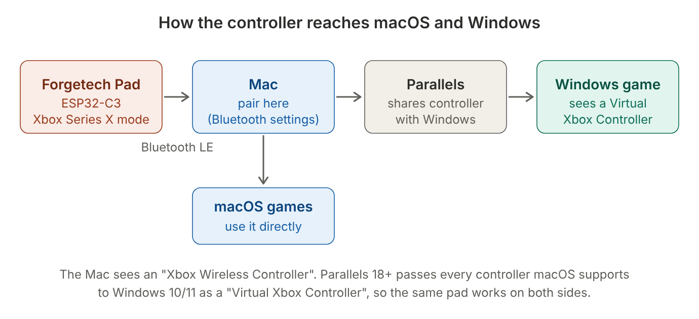
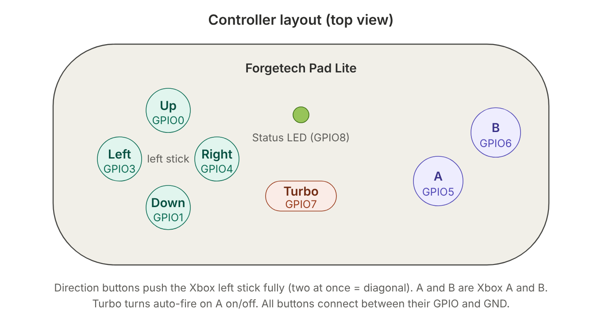
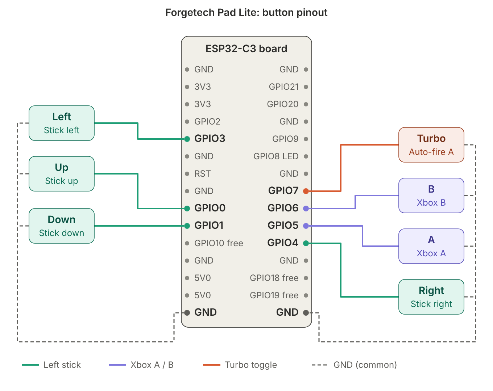
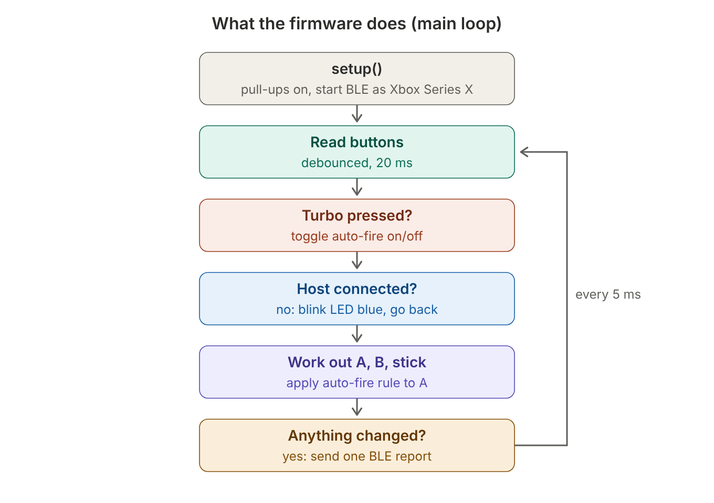
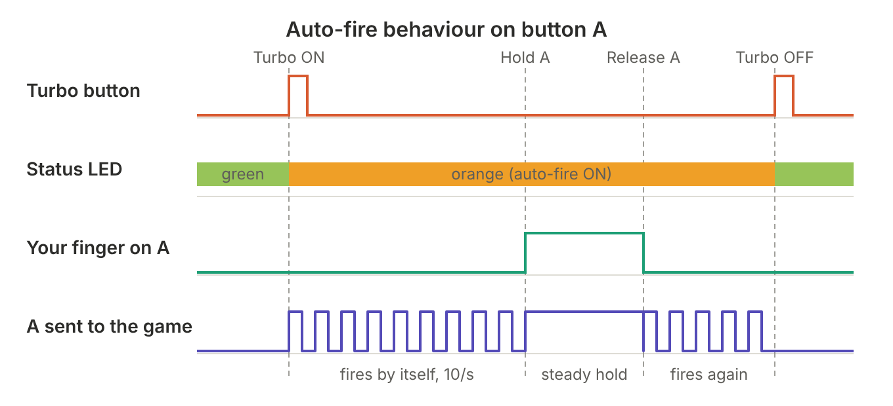

# Forgetech Pad Lite

**A wireless Bluetooth Xbox-style controller built on an ESP32-C3. By Forgetech, Lahore.**

Forgetech Pad Lite is a small game controller with **4 direction buttons, A, B and a Turbo (auto-fire) button**.
The ESP32-C3 pretends to be an **Xbox Series X Wireless Controller** over Bluetooth Low Energy, so computers treat it
like a real Xbox pad: no driver, no app. The main goal: **one controller that works on a Mac and in Windows running in
Parallels at the same time.**



---

## Contents
1. [Features](#features)
2. [Parts needed](#parts-needed)
3. [Controller layout](#controller-layout)
4. [Wiring](#wiring)
5. [How it works](#how-it-works)
6. [Auto-fire (Turbo)](#auto-fire-turbo)
7. [Status LED](#status-led)
8. [Build and flash](#build-and-flash)
9. [Pairing (Mac + Parallels)](#pairing-mac--parallels)
10. [Testing without buttons (Serial Monitor)](#testing-without-buttons-serial-monitor)
11. [Customising](#customising)
12. [Troubleshooting](#troubleshooting)
13. [Project files](#project-files)

---

## Features
- **Xbox controller emulation** (XInput, Series X profile): recognised natively by macOS, Windows and Linux.
- **Works inside Parallels**: pair once with the Mac, Windows gets it automatically as a *Virtual Xbox Controller*.
- **Direction buttons act as the left analog stick** (full tilt, proper diagonals).
- **Turbo / auto-fire on A**: A fires by itself 10 times a second; hold A to override with a steady press.
- **RGB status LED** shows pairing, connected, and auto-fire state.
- **Debounced inputs** (20 ms) so one press is always one press.
- **Battery-friendly**: a Bluetooth report is sent only when something changes.
- **Serial test mode**: press any button from the Serial Monitor without wiring anything.

## Parts needed
| Qty | Part | Notes |
|---|---|---|
| 1 | ESP32-C3-MINI-1 dev board | the version with CH340K USB-serial, RGB LED on GPIO8 |
| 7 | Push buttons (tactile switch, e.g. 6×6 mm) | Up, Down, Left, Right, A, B, Turbo |
| – | Hook-up wire | one wire per button + a shared GND wire |
| 1 | USB cable | for flashing and power |

No resistors are needed: the ESP32's internal pull-up resistors are used.

## Controller layout


| Button | What the computer sees |
|---|---|
| Up / Down / Left / Right | **Left analog stick** pushed fully in that direction. Two buttons together = diagonal. Opposite buttons cancel out. |
| A | Xbox **A** (with auto-fire, see below) |
| B | Xbox **B** |
| Turbo | Not sent to the computer: switches auto-fire on A on/off |

## Wiring


Every button has **two legs**: one leg goes to its **GPIO pin**, the other leg goes to **GND**. All GND wires can be joined together.

| Button | GPIO | Board pin |
|---|---|---|
| Up | GPIO0 | left header, pin 9 |
| Down | GPIO1 | left header, pin 10 |
| Left | GPIO3 | left header, pin 5 |
| Right | GPIO4 | right header, pin 11 |
| A | GPIO5 | right header, pin 10 |
| B | GPIO6 | right header, pin 9 |
| Turbo | GPIO7 | right header, pin 8 |
| GND (all buttons) | GND | left pin 15 / right pin 15 (any GND works) |
| Status LED | GPIO8 | onboard RGB LED, nothing to wire |

**How a button is read:** the pin is held HIGH by the internal pull-up. Pressing the button connects it to GND, so the
pin reads LOW = pressed.

**Pins kept free on purpose:**
- **GPIO2, GPIO8, GPIO9** are *strapping pins*: they decide how the chip boots. A button held on them during power-up can stop the board from starting normally.
- **GPIO20, GPIO21** are used by the CH340K chip for USB upload and the Serial Monitor.
- **GPIO10, GPIO18, GPIO19** are still free for extra buttons (see [Customising](#customising)).

## How it works


1. **Start-up:** all button pins get their pull-ups switched on. Bluetooth starts and advertises as **"Forgetech Pad Lite"**
   using the Xbox Series X profile (Microsoft's VID `0x045E` / PID `0x0B13`). That ID is why macOS and Windows load their
   built-in Xbox support.
2. **Read buttons:** every 5 ms each pin is read. A change only counts once the pin has been stable for 20 ms (debounce).
3. **Turbo button:** each press toggles auto-fire on or off.
4. **Connected?** Until a computer connects, the LED blinks blue and nothing is sent.
5. **Work out the controller state:**
   - A and B become Xbox buttons 1 and 2. When auto-fire is ON, A follows the auto-fire rule below.
   - The direction buttons become the left stick: full value (±32767) on one axis, or 70.7 % on both axes for a diagonal, so the stick stays on a circle like a real thumbstick.
6. **Send:** if anything changed since last time, one Bluetooth report is sent. If nothing changed, nothing is sent (saves battery and radio time).

**About "firmware out of date" on the Mac:** the controller reports firmware version `5.23.5.0` (a real Xbox controller
version) so macOS does not ask for an update. **Never try to update it** from the Xbox Accessories app: it is an ESP32,
not a real Xbox controller. Its firmware is changed only by flashing from PlatformIO.

## Auto-fire (Turbo)


| Situation | What A does |
|---|---|
| Turbo OFF (LED green) | Normal button: pressed while you hold it |
| Turbo ON (LED orange), A not touched | **Fires by itself**: 10 presses per second (50 ms pressed / 50 ms released) |
| Turbo ON, you press and **hold A** | Auto-fire pauses, A is **held steadily** for as long as you hold it |
| You release A (Turbo still ON) | Auto-fire **continues** |
| Press Turbo again | Auto-fire **stops**, LED back to green |

- Auto-fire works only on **A**. B and the stick are never auto-fired.
- Auto-fire is always **OFF after a restart**.
- Auto-fire only runs while a computer is connected.

## Status LED
| LED | Meaning |
|---|---|
| Blue, blinking | waiting for a computer to pair/connect |
| Green | connected, auto-fire OFF |
| Orange | connected, auto-fire ON |

## Build and flash
The project uses **PlatformIO** (VS Code extension or CLI).

```
pio run -t upload        # build and flash
pio device monitor       # open the Serial Monitor (115200 baud)
```

- Plug the USB cable into the port marked **COM** (the CH340K port), not the one marked "ESP32-C3 USB".
- Libraries are downloaded automatically: `lemmingdev/ESP32-BLE-Gamepad 0.8.0` and `h2zero/NimBLE-Arduino ^2.5.2`.
- Platform: `espressif32 @ 8.0.0`, board `esp32-c3-devkitm-1`, Arduino framework.

## Pairing (Mac + Parallels)
1. Flash the board. The LED starts **blinking blue**.
2. On the **Mac**: System Settings → Bluetooth → connect **Forgetech Pad Lite**. The LED turns **green**.
   *(If an older "Forgetech Pad Lite" or "Forgetech Pad Keys" is listed, click ⓘ → **Forget This Device** first.
   Older firmware versions used a different controller type and macOS may remember it.)*
3. Start **Windows in Parallels**. Do **not** pair from inside Windows.
4. In Windows, open **Control Panel → Devices and Printers**: it appears as **Virtual Xbox Controller**.
5. Test it: press `Win + R`, type `joy.cpl`, Enter → select the controller → **Properties**. Buttons and the stick move live.

Parallels requirements (from Parallels' documentation): **Parallels Desktop 18 or later**, **Windows 10 or newer**,
and a controller that the macOS Game Controller framework accepts. Parallels then creates the Virtual Xbox Controller in Windows.

On **Windows without Parallels**, pair it directly in Windows Bluetooth settings: it shows up as an Xbox Wireless Controller.

## Testing without buttons (Serial Monitor)
Open the Serial Monitor (115200 baud). Every input counts as pressed if its **real button is pressed OR the Serial
Monitor says so**, so you can test before soldering anything. Several commands can go on one line, separated by `;`.

| Command | What it does |
|---|---|
| `a`, `up`, `left 500` … | short press (150 ms, or the number of ms you give) |
| `press a` / `release a` | hold / let go |
| `turbo`, `turbo on`, `turbo off` | toggle / set auto-fire |
| `reset` | release everything |
| `status` | show connection, auto-fire state and what is pressed |
| `help` | list the commands |

Names: `a`, `b` (or `1`, `2`), `up`, `down`, `left`, `right`. Example: `press up; press right` = stick diagonally up-right.

## Customising
All settings are near the top of the two source files:

| What | Where | Default |
|---|---|---|
| Auto-fire speed | `TURBO_PERIOD_MS` in `src/main.cpp` | `100` → 10 shots/s (`66` ≈ 15/s, `50` = 20/s) |
| Debounce time | `DEBOUNCE_MS` in `src/main.cpp` | `20` ms |
| Bluetooth name | `DEVICE_NAME` in `src/main.cpp` | `Forgetech Pad Lite` |
| Button pins | `include/pins.h` | see [Wiring](#wiring) |

**Adding X / Y (or more buttons):** wire the new button to a free pin (GPIO10, GPIO18 or GPIO19), add it to
`pins.h` and to the `inputs[]` list in `main.cpp`, then press/release it in `sendState()`.
In this library's Xbox mode, `BUTTON_3` = X and `BUTTON_4` = Y.
Note: using GPIO18/19 disables the board's second USB port ("ESP32-C3 USB"); upload through the COM port still works.

## Troubleshooting
| Problem | Fix |
|---|---|
| Not visible in Bluetooth list | LED must be blinking blue. Press RESET on the board. If it was paired before, forget it on the computer and pair again. |
| Works on Mac, not in Windows | Pair with the **Mac**, not inside Windows. Check Parallels 18+ and Windows 10+. Look for "Virtual Xbox Controller" in Devices and Printers. |
| Mac says "firmware out of date" | Harmless. Forget the device and pair again so the Mac reads the new version. Do not try to update it. |
| A button does nothing | Check that its second leg goes to GND. Use `status` in the Serial Monitor while pressing it. |
| Board does not start / stuck in flashing mode | Make sure nothing is wired to GPIO2, GPIO8 or GPIO9. |
| Auto-fire not working | It only runs while connected (LED orange). Press Turbo once. |
| Upload fails | Use the **COM** USB port; close the Serial Monitor before uploading. |

## Project files
```
forgetech-pad-lite/
├── platformio.ini      build settings and libraries
├── include/pins.h      which GPIO each button uses
├── src/main.cpp        the firmware
└── docs/               diagrams used in this README (.png + .svg)
    └── src/            scripts that generate the diagrams (gen.py, render.js)
```

---
© Forgetech, Lahore, Pakistan.
